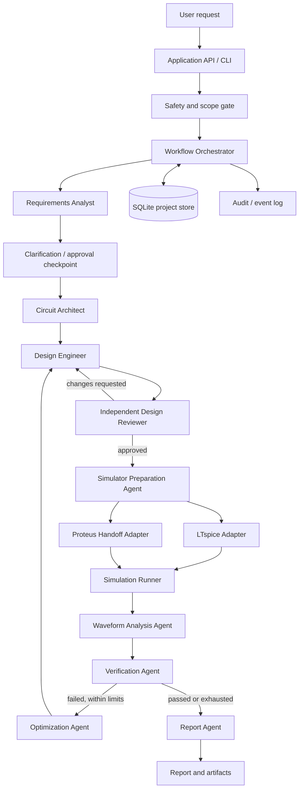

# AI Electrical Circuit Agent v0.4
## Multi-Agent Architecture — Build Specification and Implementation Instructions

**Document type:** Engineering implementation guide  
**Target:** Extend the v0.3 prototype into a modular, specialized multi-agent circuit-design workflow  
**Primary tools:** LTspice and Proteus  
**Recommended implementation language:** Python 3.11+  
**Initial operating mode:** Local-first, provider-neutral, human-supervised  
**Scope:** Low-voltage educational and laboratory simulation workflows only

---

## 1. Purpose

Build v0.4 as a coordinated system of specialized agents rather than one general-purpose agent that performs every task. Each agent owns a narrow engineering responsibility, consumes validated structured inputs, and produces a typed artifact or decision.

The system should be able to:

1. Convert a natural-language circuit request into a structured engineering brief.
2. Identify missing requirements and ask focused clarification questions.
3. Propose a circuit architecture and explain its trade-offs.
4. Produce a machine-readable circuit design representation.
5. Generate a SPICE netlist and, where supported, a graphical LTspice `.asc` schematic.
6. Prepare a Proteus handoff and invoke a configured, version-specific automation bridge.
7. Run simulations through configured simulator adapters.
8. Interpret logs, CSV measurements, and supported waveform exports.
9. Check results against explicit requirements.
10. Recommend bounded parameter changes and run controlled optimization iterations.
11. Produce a traceable engineering report with assumptions, limitations, evidence, and human-review gates.

v0.4 is a **multi-agent engineering workflow**, not an unrestricted autonomous electrical engineer. It must never claim a circuit is correct merely because a model says so or a simulator exits successfully.

## 2. Safety and scope boundary

The initial release must be restricted to low-voltage educational and laboratory simulation examples. It is not a tool for designing or validating mains-connected equipment, high-energy systems, hazardous power systems, safety-critical medical devices, or real-world protective systems.

Required safeguards:

- Reject or pause out-of-scope requests before design generation.
- Do not provide instructions for building or modifying hazardous real-world electrical systems.
- Treat simulation as educational evidence, not proof of physical safety.
- Require human review before any physical implementation.
- Do not let an LLM bypass deterministic validation or safety gates.
- Keep simulation voltage/current limits and component assumptions explicit.
- Never infer that a component is appropriately rated unless the rating is present in a trusted component definition.
- Keep all optimization bounded by declared parameter ranges and iteration limits.

The scope gate must be deterministic and conservative. If a request is ambiguous, pause and ask for clarification rather than guessing.

---

## 3. v0.4 goals and non-goals

### 3.1 Goals

- Specialized agents with explicit input/output contracts.
- A central orchestrator that controls execution order and state transitions.
- Shared, versioned project state stored in SQLite.
- Typed JSON schemas for requirements, designs, simulation runs, measurements, and review results.
- Provider abstraction so different LLM providers can be configured without changing agent logic.
- Deterministic tools for parsing, netlist generation, simulation invocation, measurement extraction, and requirement checks.
- Tool permissions assigned per agent.
- Retries, timeouts, cancellation, and resumable workflows.
- Full traceability from user requirement to design decision and simulation evidence.
- A human approval checkpoint before simulator execution if the design changes materially, and before final acceptance.

### 3.2 Non-goals for v0.4

Do not attempt to deliver all of the following in the first v0.4 milestone:

- General-purpose topology synthesis for arbitrary circuits.
- A universal native Proteus project-file writer.
- Direct manipulation of arbitrary Proteus GUI layouts without a tested bridge.
- Parsing every binary LTspice `.raw` format variant.
- Autonomous physical prototyping or hardware control.
- Unbounded evolutionary optimization.
- Claims of formal verification or certification.
- A fully autonomous multi-agent conversation in which agents can call each other without orchestration.

Use explicit orchestrator-controlled handoffs. This is easier to test, audit, and debug.

---

## 4. High-level architecture



### 4.1 Architectural principle

Agents reason; tools execute.

An LLM agent may propose a design, interpret a measurement, or recommend a change. It must not directly perform unrestricted filesystem, shell, or simulator operations. All execution must go through narrow, validated tools.

### 4.2 Main runtime components

| Component | Responsibility |
|---|---|
| API / CLI | Accept user requests and expose project status |
| Scope Gate | Deterministic scope and safety screening |
| Orchestrator | State machine, task scheduling, retries, approvals |
| Agent Runtime | Calls configured LLM provider with agent-specific instructions |
| Tool Registry | Exposes approved deterministic tools |
| Project Store | SQLite persistence for projects, tasks, artifacts, and events |
| Simulator Adapters | LTspice and Proteus integration |
| Artifact Store | Filesystem storage for generated designs and simulation outputs |
| Audit Log | Immutable-style append-only record of important actions |

---

## 5. Specialized agent responsibilities

Use the following agents as separate logical roles. They may initially share one LLM provider or model, but must have separate system instructions, schemas, tool permissions, and evaluation tests.

### 5.1 Requirements Analyst Agent

**Mission:** Convert the user's request into a precise, testable engineering specification.

Inputs:
- Original user request.
- Conversation clarification answers.
- Supported component and simulation capabilities.

Outputs:
- `requirements.json`
- Assumptions list.
- Missing-information list.
- Requirement-to-measurement mapping proposal.
- Risk/scope classification for the deterministic scope gate to validate.

Responsibilities:
- Extract intended circuit function.
- Identify inputs, outputs, operating conditions, and expected behavior.
- Distinguish mandatory requirements from preferences.
- Define measurable acceptance criteria where possible.
- Identify missing values instead of inventing them.
- Ask one focused clarification question at a time when a missing value blocks progress.

Must not:
- Generate final netlists.
- Declare a design safe.
- Invent component ratings or simulator capabilities.

### 5.2 Circuit Architect Agent

**Mission:** Select a suitable high-level circuit topology for the approved requirements.

Inputs:
- Validated requirements.
- Allowed component families.
- Supported topology patterns.

Outputs:
- `architecture.json`
- Block-level description.
- Topology rationale.
- Alternatives and trade-offs.
- Known limitations.

Responsibilities:
- Choose from supported, documented topology templates.
- Describe signal flow and functional blocks.
- Identify expected operating modes.
- Explain why the selected topology addresses the requirements.
- Flag requirements that cannot be met by the supported design library.

Must not:
- Claim a topology works without simulation evidence.
- Invent unavailable component models.
- silently relax user requirements.

### 5.3 Design Engineer Agent

**Mission:** Convert the approved architecture into a concrete, structured circuit representation.

Inputs:
- `requirements.json`
- `architecture.json`
- Component catalog.
- Design constraints.

Outputs:
- `circuit_ir.json` (canonical intermediate representation).
- `design_decisions.json`
- Proposed parameter values and ranges.
- Netlist-generation request.

Responsibilities:
- Instantiate supported components and connections.
- Assign unique reference designators.
- Define nodes and ground/reference nodes.
- Add parameter metadata and units.
- Maintain a mapping from requirements to circuit elements.
- Ensure all component and model references resolve against the catalog.

Must not:
- Directly write arbitrary simulator files.
- Use unregistered components or models.
- Modify a reviewed design without creating a new design revision.

### 5.4 Independent Design Reviewer Agent

**Mission:** Review the proposed design independently before simulation.

Inputs:
- Requirements.
- Architecture.
- `circuit_ir.json`.
- Component catalog and design rules.

Outputs:
- `design_review.json`
- Findings classified as `blocker`, `major`, `minor`, or `note`.
- Approval status: `approved`, `changes_requested`, or `rejected`.

Review checks:
- Requirement coverage.
- Missing or floating connections detectable from the IR.
- Duplicate references and invalid node names.
- Unsupported components or model identifiers.
- Unspecified values and units.
- Out-of-range parameters.
- Inconsistency between architecture and implementation.
- Missing assumptions and unresolved questions.

The reviewer must not merely repeat the Design Engineer's explanation. Use a separate prompt and require evidence references to specific IR fields.

### 5.5 Simulator Preparation Agent

**Mission:** Select and prepare the appropriate simulator workflow.

Inputs:
- Approved circuit IR.
- User's selected simulator preference.
- Available simulator adapters and capabilities.

Outputs:
- `simulation_plan.json`
- Generated netlist and schematic artifacts.
- Adapter invocation request.

Responsibilities:
- Select LTspice, Proteus, or both according to explicit user intent and available adapters.
- Generate simulator-specific files through deterministic generators.
- Validate generated files before execution.
- Record adapter version and simulator version where available.
- Pause if required simulator capabilities are unavailable.

The agent may request tools but must not execute arbitrary shell commands itself.

### 5.6 Waveform Analysis Agent

**Mission:** Interpret supported simulation outputs and produce structured measurements.

Inputs:
- Simulation run metadata.
- LTspice log, CSV, or supported waveform export.
- Measurement definitions from requirements.

Outputs:
- `measurements.json`
- `waveform_analysis.json`
- Warnings about missing, incomplete, or suspicious data.

Responsibilities:
- Extract named measurements where available.
- Calculate supported metrics from CSV data using deterministic analysis functions.
- Identify startup/transient and steady-state regions only when the measurement definition specifies how.
- Summarize observed behavior in plain language.
- Link every result to its source file and extraction method.

Must not:
- Guess missing samples.
- Report a metric without units and source.
- Treat a visual interpretation as a precise measurement.
- Parse unsupported binary formats by pretending they are CSV.

### 5.7 Verification Agent

**Mission:** Compare measured results with acceptance criteria.

Inputs:
- Requirements and acceptance criteria.
- `measurements.json`
- Simulation status and warnings.

Outputs:
- `verification.json`
- Per-requirement status: `pass`, `fail`, `not_tested`, or `inconclusive`.
- Evidence references.
- Recommended next action.

Rules:
- Requirement checks should be deterministic whenever possible.
- The LLM may explain results but must not decide numeric pass/fail when a deterministic comparison can be used.
- Missing measurements produce `not_tested` or `inconclusive`, never `pass`.
- A simulator process exit code of zero is not equivalent to requirement success.

### 5.8 Optimization Agent

**Mission:** Recommend bounded parameter changes when verification identifies a measurable failure that is eligible for optimization.

Inputs:
- Failed verification criteria.
- Circuit IR and parameter metadata.
- Prior optimization runs.
- Declared parameter bounds and objective function.

Outputs:
- `optimization_proposal.json`
- Proposed parameter delta.
- Predicted trade-offs and reason.
- Stop/continue recommendation.

Rules:
- Only parameters explicitly marked tunable may be changed.
- Respect per-parameter lower and upper bounds.
- Respect a maximum iteration count and wall-clock budget.
- Never change topology in the initial v0.4 optimizer.
- Never modify multiple unrelated parameters without recording the experiment.
- Every candidate must create a new immutable design revision.
- Do not claim improvement until a new simulation and verification run confirm it.

Use the existing bounded optimizer as the first execution engine. The agent proposes candidates; deterministic code enforces bounds and evaluates objective values.

### 5.9 Report Agent

**Mission:** Produce a concise, traceable engineering report.

Inputs:
- Requirements.
- Architecture and design revisions.
- Review results.
- Simulation runs.
- Measurements and verification.
- Optimization history.

Outputs:
- `report.md`
- Optional machine-readable `report.json`
- Artifact index.

Report sections:
1. Request summary.
2. Scope and safety limitations.
3. Requirements and assumptions.
4. Selected architecture.
5. Design summary.
6. Review findings and resolution.
7. Simulator and version details.
8. Simulation results.
9. Requirement verification table.
10. Optimization history.
11. Unresolved issues.
12. Human review checklist.
13. Artifact paths and reproducibility information.

The report must distinguish simulated evidence from assumptions and model-generated explanations.

---

## 6. Orchestrator design

The orchestrator is the only component allowed to advance the workflow state. Agents cannot directly schedule other agents.

### 6.1 Workflow states

Use explicit states:

```text
CREATED
  -> SCOPE_CHECK
  -> REQUIREMENTS_ANALYSIS
  -> NEEDS_CLARIFICATION | REQUIREMENTS_READY
  -> ARCHITECTURE_DESIGN
  -> CIRCUIT_DESIGN
  -> DESIGN_REVIEW
  -> DESIGN_REVISION | DESIGN_APPROVAL
  -> SIMULATION_PREPARATION
  -> AWAITING_SIMULATION_APPROVAL
  -> SIMULATION_RUNNING
  -> WAVEFORM_ANALYSIS
  -> REQUIREMENT_VERIFICATION
  -> OPTIMIZATION_PROPOSAL
  -> OPTIMIZATION_APPROVAL
  -> NEXT_DESIGN_REVISION
  -> REPORT_GENERATION
  -> COMPLETED | COMPLETED_WITH_WARNINGS | FAILED | CANCELLED
```

Not every project needs optimization. If all testable requirements pass, proceed to reporting. If a requirement fails but no eligible tunable parameter exists, report the failure and stop.

### 6.2 State transition rules

- Every transition must be validated by code.
- Every agent invocation creates a task record.
- Every task has a timeout, attempt count, and status.
- A failed task may be retried only according to a configured retry policy.
- Never retry a simulator run indefinitely.
- Human approval is a persisted state, not a transient console prompt.
- A resumed workflow must load the latest valid project state from SQLite.
- A new design revision must not overwrite the prior revision.

### 6.3 Example orchestration pseudocode

```python
async def execute_project(project_id: str) -> None:
    project = await store.load_project(project_id)

    scope = await scope_gate.check(project.request)
    await store.record_scope_result(project_id, scope)
    if not scope.allowed:
        await store.transition(project_id, "FAILED")
        return

    requirements = await agents.requirements.run(project)
    await store.save_artifact(project_id, "requirements", requirements)

    if requirements.needs_clarification:
        await store.transition(project_id, "NEEDS_CLARIFICATION")
        return

    architecture = await agents.architect.run(requirements)
    design = await agents.design_engineer.run(requirements, architecture)

    review = await agents.design_reviewer.run(
        requirements=requirements,
        architecture=architecture,
        design=design,
    )

    if review.status != "approved":
        await store.transition(project_id, "DESIGN_REVISION")
        return

    await store.transition(project_id, "AWAITING_SIMULATION_APPROVAL")
    # Continue only after a persisted user approval.

    simulation_plan = await agents.simulator_prep.run(design)
    run = await simulator_registry.run(simulation_plan)

    measurements = await agents.waveform_analysis.run(run, requirements)
    verification = await agents.verification.run(
        requirements, measurements, run
    )

    if verification.has_eligible_failures:
        proposal = await agents.optimizer.propose(
            design, verification, project.optimization_budget
        )
        # Validate bounds and require approval before another run.

    report = await agents.report.run(project, verification)
    await store.save_artifact(project_id, "report", report)
```

This is illustrative pseudocode. Implement real state transitions and persistence rather than copying it as a complete runtime.

---

## 7. Agent communication contracts

Agents communicate through structured artifacts, not free-form chat transcripts.

### 7.1 Common envelope

Every agent response must conform to a common envelope:

```json
{
  "schema_version": "1.0",
  "project_id": "project-id",
  "task_id": "task-id",
  "agent": "requirements_analyst",
  "status": "success",
  "created_at": "2026-01-01T12:00:00Z",
  "input_artifact_ids": [],
  "output_artifact_ids": [],
  "summary": "Short result summary",
  "warnings": [],
  "errors": []
}
```

Use actual UTC timestamps at runtime. The date above is an example only.

### 7.2 Artifact versioning

Each artifact must include:
- `artifact_id`
- `project_id`
- `artifact_type`
- `schema_version`
- `revision`
- `created_by`
- `created_at`
- `content_hash`
- `storage_path`
- `parent_artifact_ids`

Never silently replace an artifact. A revision creates a new artifact linked to its parent.

### 7.3 JSON Schema requirements

Create JSON Schema files for:
- `requirements.schema.json`
- `architecture.schema.json`
- `circuit_ir.schema.json`
- `design_review.schema.json`
- `simulation_plan.schema.json`
- `simulation_run.schema.json`
- `measurements.schema.json`
- `verification.schema.json`
- `optimization_proposal.schema.json`
- `report.schema.json`

Validate every agent response before storing or passing it to another agent. Reject malformed output and allow one constrained repair attempt. Do not execute tools based on invalid output.

---

## 8. Canonical circuit intermediate representation

Create `circuit_ir.json` as the simulator-independent source of truth. LTspice and Proteus generators must consume this representation rather than each other’s files.

Illustrative structure:

```json
{
  "schema_version": "1.0",
  "design_id": "design-001",
  "design_revision": 1,
  "title": "Educational RC low-pass example",
  "units": "SI",
  "nodes": [
    {"id": "0", "kind": "ground"},
    {"id": "vin", "kind": "signal"},
    {"id": "vout", "kind": "signal"}
  ],
  "components": [
    {
      "ref": "R1",
      "kind": "resistor",
      "model": "ideal_resistor",
      "pins": {"1": "vin", "2": "vout"},
      "parameters": {"resistance_ohm": 1000},
      "tunable": false
    },
    {
      "ref": "C1",
      "kind": "capacitor",
      "model": "ideal_capacitor",
      "pins": {"1": "vout", "2": "0"},
      "parameters": {"capacitance_farad": 1e-6},
      "tunable": false
    }
  ],
  "analyses": [
    {
      "kind": "transient",
      "stop_time_s": 0.02,
      "max_step_s": 0.00001
    }
  ],
  "measurements": [
    {
      "id": "output_peak",
      "kind": "peak",
      "signal": "V(vout)",
      "unit": "V"
    }
  ],
  "source_requirements": ["REQ-001"]
}
```

This is a data-contract example, not a guarantee that every simulator adapter supports every field.

### 8.1 IR validation

Implement deterministic checks:
- Unique component references.
- Valid component kinds.
- Valid pin names for each component kind.
- All referenced nodes exist.
- Ground node exists where required.
- Parameter values are numeric and have supported units.
- Every model exists in the component catalog.
- Every analysis kind is supported by the selected adapter.
- Every measurement expression is supported.
- Tunable parameter bounds are present and ordered.
- No unrecognized fields are silently ignored.

---

## 9. LLM provider and model abstraction

Do not couple agent implementations to one model vendor.

Define a provider interface:

```python
class LLMProvider(Protocol):
    async def generate(
        self,
        *,
        system_prompt: str,
        user_payload: dict,
        response_schema: dict,
        model: str | None = None,
        timeout_s: float = 60,
    ) -> dict:
        ...
```

Implement:
- Provider registry.
- Model configuration per agent.
- Timeout and retry policy.
- Token-budget configuration.
- Structured-output validation.
- Redaction of secrets from logs.
- Usage and latency tracking.

Suggested configuration:

```yaml
agents:
  requirements_analyst:
    provider: default
    model: configured-model
    temperature: 0.1
    timeout_seconds: 60
    max_retries: 1

  circuit_architect:
    provider: default
    model: configured-model
    temperature: 0.2
    timeout_seconds: 90
    max_retries: 1

  design_reviewer:
    provider: reviewer
    model: configured-review-model
    temperature: 0.0
    timeout_seconds: 90
    max_retries: 1
```

Use placeholders in committed configuration. Never commit API keys. Load credentials from environment variables or a secrets manager. A separate reviewer model is useful when available, but independence must come from separate review instructions and evidence-based checks, not merely from choosing another vendor.

---

## 10. Tool registry and permissions

Expose tools as narrow functions with typed arguments and outputs.

Suggested tools:

| Tool | Allowed role(s) | Purpose |
|---|---|---|
| `validate_requirements` | Requirements Analyst, Orchestrator | Validate requirements |
| `lookup_component` | Architect, Design Engineer | Query approved component catalog |
| `validate_circuit_ir` | Design Engineer, Reviewer, Orchestrator | Deterministic IR checks |
| `generate_spice_netlist` | Simulator Preparation | Generate netlist |
| `generate_ltspice_asc` | Simulator Preparation | Generate supported `.asc` |
| `prepare_proteus_handoff` | Simulator Preparation | Create handoff bundle |
| `run_ltspice` | Orchestrator via LTspice adapter | Run configured simulator |
| `run_proteus_bridge` | Orchestrator via Proteus adapter | Invoke configured bridge |
| `parse_simulation_log` | Waveform Analysis | Parse supported log formats |
| `analyze_csv_waveform` | Waveform Analysis | Calculate supported metrics |
| `verify_measurements` | Verification Agent | Deterministic requirement checks |
| `propose_parameter_sweep` | Optimization Agent | Generate bounded candidates |
| `write_report` | Report Agent | Assemble report |

Permission rules:
- Agents cannot access arbitrary shell execution.
- Agents cannot choose arbitrary filesystem paths.
- Agents cannot access environment variables or secrets.
- Simulator execution is mediated by adapters and orchestrator policy.
- File paths must resolve inside the project workspace.
- Tool arguments must be schema-validated.
- All tool calls must be logged with input hash, output hash, duration, and status.

---

## 11. LTspice adapter

Reuse and improve the v0.3 LTspice-related scripts.

Responsibilities:
1. Consume canonical circuit IR.
2. Generate a SPICE netlist.
3. Generate a graphical `.asc` only for the supported symbol and wiring subset.
4. Validate that all expected output files exist.
5. Invoke LTspice only when an executable is explicitly configured.
6. Capture stdout, stderr, exit status, and generated files.
7. Parse supported log and CSV exports.
8. Record LTspice version when it can be queried reliably.

Do not treat successful file generation as successful simulation.

### 11.1 Adapter interface

```python
class SimulatorAdapter(Protocol):
    name: str

    def capabilities(self) -> dict:
        ...

    async def prepare(self, circuit_ir: dict, workspace: Path) -> dict:
        ...

    async def run(self, prepared: dict, timeout_s: int) -> dict:
        ...

    async def collect_outputs(self, run_result: dict) -> dict:
        ...
```

### 11.2 LTspice limitations

- Keep the graphical generator explicitly limited to known symbols and pin mappings.
- Require a validation/open-in-LTspice check for generated `.asc` files.
- Do not promise support for arbitrary symbols, subcircuits, or custom models.
- Binary `.raw` parsing remains out of scope unless a tested parser is added.
- Prefer deterministic `.meas` output and CSV export for initial metrics.

---

## 12. Proteus adapter and handoff

Proteus project formats and automation behavior can vary by version. Do not implement a guessed universal file writer.

Use a bridge contract:

1. Create a handoff directory containing the canonical IR, netlist where relevant, component mapping, and a manifest.
2. If configured, copy or populate a user-provided blank Proteus template project.
3. Invoke a user-supplied, version-tested bridge script through a restricted adapter.
4. Capture bridge output and generated project files.
5. Mark the result as `prepared`, `opened`, `simulated`, or `failed` based on evidence.
6. Require manual confirmation if the bridge cannot reliably report the result.

Example bridge manifest:

```json
{
  "schema_version": "1.0",
  "design_id": "design-001",
  "target": "proteus",
  "template_project": "templates/proteus/blank-project",
  "bridge_command": "configured-by-host",
  "expected_outputs": ["project-file"],
  "status": "prepared"
}
```

Never put an arbitrary bridge command supplied by an LLM directly into a shell. Configure the executable and arguments in trusted application configuration.

---

## 13. Waveform analysis pipeline

Implement deterministic analysis functions first. The Waveform Analysis Agent should explain results from these functions rather than invent numeric results.

Initial supported inputs:
- LTspice `.log` measurement text.
- CSV waveform exports with named columns.
- Explicitly documented plain-text measurement files.

Initial metric functions:
- Minimum and maximum.
- Peak-to-peak.
- Mean and RMS.
- Rise/fall time only when thresholds and edge-selection rules are defined.
- Settling time only when target, tolerance band, and observation window are defined.
- Frequency/period only when signal and detection assumptions are specified.

Each measurement must include:
- Metric ID.
- Numeric value.
- Unit.
- Signal name.
- Source artifact ID and file.
- Extraction method.
- Sample count or log reference.
- Warnings and confidence limitations.

Do not silently extrapolate, interpolate, smooth, or discard samples. If processing is necessary, record the method and parameters.

---

## 14. Verification model

Use deterministic comparisons.

Example requirement:

```json
{
  "id": "REQ-OUT-001",
  "description": "Output peak remains within the specified educational target range",
  "measurement_id": "output_peak",
  "operator": "between",
  "target": {"min": 0.0, "max": 5.0},
  "unit": "V",
  "severity": "required"
}
```

Supported operators:
- `eq`
- `lt`
- `lte`
- `gt`
- `gte`
- `between`
- `abs_error_lte`
- `relative_error_lte`

Define numeric tolerance and rounding rules. Unit conversion must be explicit and tested. Missing measurements are not passes.

Verification output example:

```json
{
  "requirement_id": "REQ-OUT-001",
  "status": "pass",
  "observed": 3.2,
  "unit": "V",
  "criterion": "between 0.0 and 5.0 V",
  "evidence": ["measurement-output-peak"]
}
```

---

## 15. Bounded optimization loop

The optimization loop must be a controlled experiment cycle:

```text
Verification failure
  -> determine whether failure is optimizable
  -> create candidate proposal
  -> validate tunable parameter and bounds
  -> persist candidate design revision
  -> request approval according to policy
  -> run simulation
  -> extract measurements
  -> verify again
  -> compare objective and constraints
  -> continue only if budget remains
```

Configuration example:

```yaml
optimization:
  enabled: true
  max_iterations: 5
  max_candidates_per_iteration: 8
  require_user_approval_each_iteration: true
  allow_topology_changes: false
  stop_on_simulator_error: true
  objective:
    measurement_id: output_error
    direction: minimize
  parameter_bounds:
    R1:
      resistance_ohm:
        min: 100
        max: 10000
```

The optimizer must:
- Reject out-of-bounds candidates.
- Keep a complete experiment history.
- Avoid duplicate candidates.
- Stop on repeated simulator failures.
- Stop when no meaningful improvement occurs for a configured number of iterations.
- Never relax acceptance criteria to make a candidate pass.

---

## 16. Persistence and database design

Use SQLite for the first release. Keep database access behind a repository layer so a later database migration does not affect agent logic.

Suggested tables:

### `projects`
- `id`
- `name`
- `request_text`
- `status`
- `created_at`
- `updated_at`
- `config_json`

### `tasks`
- `id`
- `project_id`
- `agent_name`
- `task_type`
- `status`
- `attempt`
- `started_at`
- `finished_at`
- `input_artifact_id`
- `output_artifact_id`
- `error_json`

### `artifacts`
- `id`
- `project_id`
- `artifact_type`
- `schema_version`
- `revision`
- `created_by`
- `storage_path`
- `content_hash`
- `parent_ids_json`
- `created_at`

### `simulation_runs`
- `id`
- `project_id`
- `design_artifact_id`
- `adapter`
- `simulator_version`
- `status`
- `started_at`
- `finished_at`
- `exit_code`
- `result_json`

### `measurements`
- `id`
- `project_id`
- `simulation_run_id`
- `measurement_key`
- `value`
- `unit`
- `source_artifact_id`
- `metadata_json`

### `approvals`
- `id`
- `project_id`
- `subject_type`
- `subject_id`
- `decision`
- `comment`
- `created_at`

### `events`
- `id`
- `project_id`
- `event_type`
- `actor`
- `payload_json`
- `created_at`

Use foreign keys, indexes on project/task status, and database migrations. Store large artifacts on disk and their metadata in SQLite.

---

## 17. Suggested repository structure

Extend the v0.3 repository toward this structure. Preserve existing scripts where practical and migrate functionality incrementally.

```text
ai-electrical-circuit-agent/
├── AGENT.md
├── README.md
├── pyproject.toml
├── requirements.txt
├── .env.example
├── config/
│   ├── agents.yaml
│   ├── app.yaml
│   ├── simulators.yaml
│   └── optimization.yaml
├── schemas/
│   ├── common.schema.json
│   ├── requirements.schema.json
│   ├── architecture.schema.json
│   ├── circuit_ir.schema.json
│   ├── design_review.schema.json
│   ├── simulation_plan.schema.json
│   ├── simulation_run.schema.json
│   ├── measurements.schema.json
│   ├── verification.schema.json
│   └── optimization_proposal.schema.json
├── src/
│   └── circuit_agent/
│       ├── __init__.py
│       ├── main.py
│       ├── api/
│       │   ├── app.py
│       │   └── routes/
│       ├── orchestrator/
│       │   ├── engine.py
│       │   ├── state_machine.py
│       │   ├── policies.py
│       │   └── approvals.py
│       ├── agents/
│       │   ├── base.py
│       │   ├── requirements_analyst.py
│       │   ├── circuit_architect.py
│       │   ├── design_engineer.py
│       │   ├── design_reviewer.py
│       │   ├── simulator_prep.py
│       │   ├── waveform_analyst.py
│       │   ├── verification.py
│       │   ├── optimizer.py
│       │   └── report_writer.py
│       ├── llm/
│       │   ├── base.py
│       │   ├── registry.py
│       │   └── providers/
│       ├── tools/
│       │   ├── registry.py
│       │   ├── permissions.py
│       │   ├── ir_validator.py
│       │   ├── netlist_generator.py
│       │   ├── asc_generator.py
│       │   ├── waveform_metrics.py
│       │   └── report_builder.py
│       ├── simulators/
│       │   ├── base.py
│       │   ├── registry.py
│       │   ├── ltspice/
│       │   └── proteus/
│       ├── domain/
│       │   ├── models.py
│       │   ├── enums.py
│       │   └── errors.py
│       ├── storage/
│       │   ├── database.py
│       │   ├── repositories/
│       │   └── migrations/
│       └── safety/
│           ├── scope_gate.py
│           └── policy.py
├── skills/
│   ├── requirements-analysis/
│   ├── circuit-architecture/
│   ├── circuit-design/
│   ├── design-review/
│   ├── graphical-ltspice/
│   ├── proteus-native/
│   ├── waveform-interpretation/
│   ├── autonomous-optimization/
│   └── autonomous-design-engine/
├── scripts/
│   ├── design_agent.py
│   ├── run_ltspice.py
│   ├── proteus_handoff.py
│   ├── interpret_waveforms.py
│   └── optimize.py
├── examples/
│   └── rc_lowpass/
├── templates/
│   └── reports/
├── runs/
└── tests/
    ├── unit/
    ├── integration/
    ├── contract/
    ├── safety/
    └── fixtures/
```

---

## 18. API and CLI

Keep the CLI as the first supported interface. Add an API only after the orchestration core is stable.

Suggested commands:

```bash
# Validate a project specification
circuit-agent validate examples/rc_lowpass/spec.json

# Create a project without running a simulator
circuit-agent create examples/rc_lowpass/spec.json

# Run the workflow until it reaches a human approval checkpoint
circuit-agent run PROJECT_ID

# Inspect status and pending approvals
circuit-agent status PROJECT_ID

# Approve a specific design revision for simulation
circuit-agent approve PROJECT_ID --subject design --revision 1

# Resume a paused workflow
circuit-agent resume PROJECT_ID

# Cancel a project
circuit-agent cancel PROJECT_ID

# Export the final report and artifacts
circuit-agent export PROJECT_ID --out ./exports/PROJECT_ID
```

API endpoints, if implemented:

| Method | Endpoint | Purpose |
|---|---|---|
| `POST` | `/projects` | Create project |
| `GET` | `/projects/{id}` | Project status |
| `POST` | `/projects/{id}/run` | Start/resume workflow |
| `POST` | `/projects/{id}/approvals` | Record approval |
| `POST` | `/projects/{id}/cancel` | Cancel workflow |
| `GET` | `/projects/{id}/artifacts` | List artifacts |
| `GET` | `/projects/{id}/events` | Audit timeline |

Do not expose arbitrary tool execution through the API.

---

## 19. Configuration and environment

Example `.env.example`:

```dotenv
APP_ENV=development
DATABASE_URL=sqlite:///./data/circuit_agent.db
ARTIFACT_ROOT=./runs
DEFAULT_LLM_PROVIDER=default
DEFAULT_LLM_MODEL=configure-me
LLM_API_KEY=
LTSPICE_EXECUTABLE=
PROTEUS_BRIDGE_EXECUTABLE=
PROTEUS_TEMPLATE_PROJECT=
LOG_LEVEL=INFO
```

Configuration files must contain non-secret settings only. Validate configuration at startup and clearly report missing optional integrations. The app should still support artifact-only mode without a simulator or LLM provider, using a supplied structured specification and deterministic tools.

---

## 20. Error handling and resilience

Define typed errors:
- `ScopeRejected`
- `ClarificationRequired`
- `SchemaValidationError`
- `AgentInvocationError`
- `ToolPermissionError`
- `ArtifactNotFound`
- `SimulatorNotConfigured`
- `SimulatorTimeout`
- `SimulatorExecutionError`
- `UnsupportedWaveformFormat`
- `VerificationIncomplete`
- `ApprovalRequired`
- `OptimizationBudgetExceeded`

Resilience requirements:
- Persist task status before and after execution.
- Use bounded retries for transient provider errors.
- Do not retry schema-invalid outputs endlessly.
- Use subprocess timeouts and terminate child processes on cancellation.
- Capture simulator stdout/stderr in project artifacts.
- Make operations idempotent where possible.
- Resume from the last completed state without rerunning completed simulations unless inputs changed.
- Use content hashes to detect stale outputs.
- Mark downstream artifacts stale when an upstream design revision changes.

---

## 21. Observability and auditability

Every important action must create an event:
- Project created.
- Scope check completed.
- Agent task started/completed/failed.
- Artifact created.
- Design revision created.
- Review decision recorded.
- User approval recorded.
- Simulator invoked and completed.
- Measurement extracted.
- Requirement passed/failed.
- Optimization candidate proposed and evaluated.
- Report generated.

Log:
- Project ID and task ID.
- Agent name and configured model identifier.
- Provider latency and token usage when available.
- Tool name and validated arguments (redact secrets).
- Artifact IDs and hashes.
- Error category and safe diagnostic message.

Do not log API keys, access tokens, or private credentials.

---

## 22. Testing strategy

Use pytest and test each layer independently.

### 22.1 Unit tests

- JSON Schema validation.
- Circuit IR validation.
- Requirement comparison operators.
- Unit conversion.
- Netlist generation.
- LTspice ASC generation for supported symbols.
- Proteus handoff manifest generation.
- CSV waveform metric calculations.
- Optimization bounds and stopping rules.
- State transition legality.
- Artifact hashing and revision creation.

### 22.2 Contract tests

For every agent:
- Valid input produces schema-valid output.
- Missing required input produces a controlled error or clarification.
- Invalid model output is rejected.
- Agent cannot call tools outside its permissions.
- Agent output references existing input artifacts.
- Reviewer findings cite concrete design fields.

### 22.3 Integration tests

- Full artifact-only workflow with a mock LLM.
- Full workflow with a fake simulator adapter.
- LTspice adapter using a tiny known educational fixture when LTspice is available.
- Proteus bridge contract test using a fake bridge executable.
- Workflow pause, approval, resume, and cancellation.
- Crash recovery after each major state transition.
- Optimization across a fixed deterministic test fixture.

### 22.4 Safety tests

- Out-of-scope requests are stopped before design generation.
- Ambiguous requests pause for clarification.
- LLM output cannot override the scope gate.
- Arbitrary shell commands are rejected.
- Paths outside the project workspace are rejected.
- Optimization candidates outside declared bounds are rejected.
- Missing measurements never pass verification.
- Simulator success alone never marks requirements as passed.

### 22.5 End-to-end acceptance test

Use the existing educational RC low-pass example as the first reference project.

Expected workflow:
1. Load a structured requirements file.
2. Validate it.
3. Produce architecture and circuit IR.
4. Review and approve the IR.
5. Generate SPICE netlist and supported `.asc`.
6. Run against a configured simulator or fake adapter.
7. Parse a known CSV/log fixture.
8. Verify explicitly defined requirements.
9. Generate a report with all evidence paths.

The test must be repeatable without an LLM API key by using deterministic mock agent outputs.

---

## 23. Phased implementation plan

Do not implement every agent and simulator integration simultaneously. Build in vertical slices.

### Phase 0 — Repository stabilization

Tasks:
- Inspect all v0.3 files and tests.
- Record current behavior and known limitations.
- Preserve existing scripts as compatibility entry points.
- Add `pyproject.toml`, formatting, linting, and pytest configuration.
- Move code into `src/circuit_agent/` gradually.
- Add a migration note for old CLI commands.

Exit criteria:
- Existing v0.3 smoke tests still pass.
- No existing example is lost.
- CI can install and run unit tests.

### Phase 1 — Domain models and schemas

Tasks:
- Define Pydantic domain models or equivalent typed structures.
- Create all JSON Schemas.
- Implement canonical circuit IR.
- Implement schema validation and artifact versioning.
- Add component catalog format.

Exit criteria:
- Valid example passes.
- Invalid nodes, pins, units, and references fail with useful messages.
- Every artifact has a version and content hash.

### Phase 2 — Orchestrator and persistence

Tasks:
- Implement SQLite repositories and migrations.
- Implement workflow state machine.
- Implement task records and event log.
- Implement pause/resume/approval/cancel behavior.
- Add a mock agent runtime.

Exit criteria:
- Workflow can run without an LLM.
- Process restart resumes from persisted state.
- Illegal state transitions are rejected.

### Phase 3 — Agent framework and first agents

Implement in this order:
1. Requirements Analyst.
2. Circuit Architect.
3. Design Engineer.
4. Independent Design Reviewer.
5. Report Agent.

Tasks:
- Base agent class.
- Prompt templates stored as versioned files.
- Provider interface and mock provider.
- Strict response schemas.
- Tool permission checks.
- Agent contract tests.

Exit criteria:
- RC example produces requirements, architecture, IR, review, and report artifacts.
- Reviewer can request changes and orchestrator can create a new revision.

### Phase 4 — Simulator adapters

Tasks:
- Refactor existing LTspice scripts behind adapter interface.
- Keep `.asc` generation capability limits explicit.
- Refactor Proteus handoff into an adapter.
- Add fake simulator adapter.
- Add simulator capability discovery and preflight checks.

Exit criteria:
- Both adapters implement the same interface.
- Fake adapter supports integration tests.
- LTspice integration works on a configured installation.
- Proteus handoff produces a reproducible bundle; native automation is reported only when verified by the configured bridge.

### Phase 5 — Waveform analysis and verification

Tasks:
- Standardize measurement definitions.
- Implement deterministic metrics.
- Parse supported logs and CSV files.
- Implement requirement comparison engine.
- Add verification agent for explanation and gap analysis.

Exit criteria:
- Every pass/fail result is traceable to a measurement and criterion.
- Missing data produces `not_tested` or `inconclusive`.
- Fixture tests cover normal and malformed files.

### Phase 6 — Bounded optimization

Tasks:
- Adapt existing optimizer to canonical IR revisions.
- Add tunable parameter metadata and bounds.
- Add candidate deduplication.
- Add iteration and time budgets.
- Add approval checkpoints.
- Add optimization history and objective comparison.

Exit criteria:
- Out-of-range proposals are rejected.
- Each candidate creates a new design revision.
- An improvement is accepted only after simulation and verification.

### Phase 7 — User interface and host integration

Tasks:
- Stabilize CLI.
- Add API endpoints if needed.
- Add project timeline and artifact listing.
- Add provider configuration.
- Add clear approval prompts.
- Document how to connect a host agent or UI.

Exit criteria:
- A user can create, inspect, approve, resume, and export a project.
- The host UI does not bypass orchestrator policies.

### Phase 8 — Release hardening

Tasks:
- Run all tests.
- Validate clean installation.
- Test on a machine without LTspice/Proteus installed.
- Test simulator timeouts and process cancellation.
- Audit secrets and file-path handling.
- Review all generated reports for claims unsupported by evidence.
- Update README, architecture diagrams, and release notes.

Exit criteria:
- v0.4 release checklist completed.
- Known limitations documented.
- No claim of universal circuit design or physical safety.

---

## 24. Coding standards for the implementation agent

When using Codex or another coding agent, follow these rules:

1. Read `AGENT.md`, README, and the existing v0.3 implementation before changing files.
2. Do not replace the existing implementation wholesale.
3. Work phase by phase; do not skip tests.
4. Keep agent reasoning separate from deterministic execution code.
5. Use type hints for public functions.
6. Use dataclasses or Pydantic models for domain objects.
7. Use dependency injection for providers, stores, and simulators.
8. Keep prompts in files, not embedded throughout Python modules.
9. Validate all model output before using it.
10. Never let model output become a shell command.
11. Use `subprocess` with argument arrays, explicit working directories, and timeouts.
12. Restrict file operations to the project workspace.
13. Add tests with each feature.
14. Keep simulator-specific behavior inside adapters.
15. Keep the canonical IR simulator-independent.
16. Do not mark requirements as passed without deterministic evidence.
17. Preserve prior artifacts and revisions.
18. Update documentation when interfaces or behavior change.
19. If a feature cannot be implemented reliably, expose a clear capability limitation instead of a fragile approximation.
20. At the end of each phase, summarize changed files, tests run, results, and known gaps.

---

## 25. Definition of done for v0.4

v0.4 is ready when all of the following are true:

- [ ] Specialized agents have separate instructions, schemas, and tool permissions.
- [ ] Orchestrator controls all workflow transitions.
- [ ] Project and task state persist in SQLite.
- [ ] Artifacts are versioned and content-hashed.
- [ ] Requirements, architecture, circuit IR, review, simulation, measurement, and verification schemas exist.
- [ ] The RC example completes in mock mode without external credentials.
- [ ] Design review can block a design and request a revision.
- [ ] Human approval is required at configured checkpoints.
- [ ] LTspice adapter works where LTspice is installed and reports capability limitations.
- [ ] Proteus handoff works and native automation is claimed only when the bridge confirms it.
- [ ] Waveform analysis reports source-linked measurements.
- [ ] Verification is deterministic for supported criteria.
- [ ] Optimization is bounded, versioned, and approval-controlled.
- [ ] Reports distinguish assumptions, model explanations, and simulator evidence.
- [ ] Safety, permissions, cancellation, timeout, and recovery tests pass.
- [ ] Documentation explains installation, configuration, operation, and limitations.

---

## 26. Recommended first implementation sprint

Start with the smallest complete vertical slice:

1. Inspect and baseline-test v0.3.
2. Add the canonical `CircuitIR` model and schema.
3. Add `AgentResult` and artifact envelope models.
4. Add the SQLite `projects`, `tasks`, `artifacts`, and `events` tables.
5. Implement the orchestrator state machine.
6. Implement mock Requirements Analyst, Architect, Design Engineer, and Reviewer agents.
7. Run the RC example end-to-end in artifact-only mode.
8. Add the Report Agent.
9. Only then connect a real LLM provider.
10. Add simulator adapters after the mock workflow is stable.

This sequence prevents provider integration and simulator quirks from obscuring core orchestration bugs.

## 27. Final architectural recommendation

For v0.4, use a **central orchestrator with specialized, stateless agent roles and shared versioned project state**.

Avoid a free-form swarm where agents message each other without a controller. A controlled workflow is more reproducible, easier to test, cheaper to operate, and safer to audit. Keep the canonical circuit IR as the boundary between reasoning and simulator execution. Let deterministic tools perform validation, file generation, simulation invocation, measurement extraction, and requirement comparison. Let agents handle interpretation, topology proposals, design critique, and explanations.

The result should be a modular foundation that can later support additional simulators, component libraries, model providers, and richer design capabilities without rewriting the core workflow.

